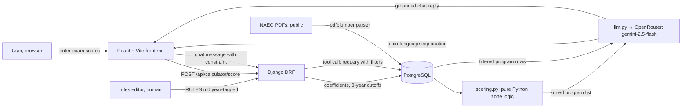

# Design Review · Abiturienti · API Atlas

Members: Mariam Pkhaladze · MariamPKH1 · backend and APIs · Kvirike Gabunia · KVIRIKE7 · frontend and UX · Irakli Kimutsadze · Irakli-Kimutsadze · testing, CI and deployment · Repo: https://github.com/MariamPkh1/capstone-project · Graded commit: tag `design-review`

## 1 · Problem, users, success criteria

**Problem.** Georgian university applicants (abiturientebi) lose their preferred university place not because their scores are too low, but because they list programs in the wrong order on the NAEC priority list. The NAEC system assigns each applicant to the first program they qualify for — a less-wanted program placed above a more-wanted one costs them the better place. The decision is one-shot, time-pressured, and high-stakes. No tool exists today that explains the ordering logic in plain language and lets a student push back on it.

**Users.** Georgian high-school graduates (17–19) who have sat national exams and are filling the NAEC priority list. Secondary users: parents helping their child choose. Full spec: `docs/spec.md`.

| # | Success criterion | Measured by | Today |
|---|---|---|---|
| S1 | Given valid scores, `/api/calculator/score` returns a correctly-zoned list for every program in the database | `pytest` golden set; p95 latency under 500 ms (no LLM in this path) | in progress — Freeuni slice |
| S2 | The LLM explanation never states a cutoff number that differs from the database value | AC6 check in `tests/`; golden question g4 | planned Week 2 |
| S3 | 9 of 10 golden questions return the correct zone and ordering advice | `evals/golden.yaml` live run | planned Week 11 |
| S4 | All LLM calls log model, tokens, cost, and latency | `logs/usage.jsonl` present and non-empty | planned Week 2 |

## 2 · Architecture and data flow

| Model call | Model id | Input | Output | Validated by |
|---|---|---|---|---|
| Calculator explainer | `google/gemini-2.5-flash` via OpenRouter | zoned list + program rows (≈ 500 tokens) | plain-language priority explanation | AC6: response may not state a cutoff not in the DB result |
| Chat refinement | `google/gemini-2.5-flash` via OpenRouter | system prompt + tool results + history (≈ 2,000 tokens) | answer or tool call request | AC6 same check; tool executor re-runs scoring with new constraints |

Scoring is pure Python — the LLM never touches a number directly. The arrow from Chat back to PostgreSQL is the tool call path: the model requests a requery with updated constraints (city, grant, field), the Django executor runs it, and the model explains the new result. The NAEC PDF parser is an offline human step: one person verifies the parsed CSV against the source document before it is loaded into the database, and the `rules_version` field on every API response flags stale data to the frontend.

## 3 · Risks and safety threats

| Risk | What a user would see | Mitigation | Owner |
|---|---|---|---|
| LLM states a cutoff not in the DB | Student trusts a wrong threshold, lists programs incorrectly | AC6: system prompt forbids stating numbers absent from tool result; golden g4 catches this; `tests/test_chat.py` checks every response | Mariam |
| Wrong zone costs a student a real place | Student treats a Reach as Safe and loses a preferred program | Zones show the 3-year range and a confidence level, never a single verdict; `scoring.py` is deterministic and fully unit-tested | Kvirike |
| PDF parser corrupts admission statistics | A wrong cutoff enters the DB silently | Parser tested against one university table before full load; output CSV committed and spot-checked; `data_version` in every response | Irakli |
| Scoring coefficients change year-to-year | 2025 rule applied to 2026 scores | Every rule in `RULES.md` has a source link and a year tag; `rules_version` sent in every API response; breaking change bumps the version | Mariam |
| LLM is instructed by a crafted input to state wrong numbers | Student receives a manipulated answer | Calculator path has no LLM; chat system prompt treats retrieved rows as data, not instructions; refusal golden questions test this boundary | Irakli |

## 4 · Evaluation plan

- Golden set: `evals/golden.yaml` · last run: `evals/results/2026-10-19-offline-stub.json` · result: 2/5 (0.40) — offline stub; live run pending
- What failed and why: g3 (ordering warning) and g5 (refusal) require the live Django service and LLM; g4 (incomplete input validation) is not yet implemented — planned Week 2. The two passing items (g1 zone computation, g2 no-safe-zone warning) run against the pure Python scoring logic offline.
- What the 0.70 gate will block: any merge to `main` that drops the pass rate below 0.70 in CI
- By Week 11: expand to 10 questions — 3 factual (zone, score arithmetic, grant cutoff), 2 reasoning (ordering logic with mixed zones), 2 edge (all Reach, retake scenario with +10 points), 2 refusal (hallucinated cutoff, constrained city with no results), 1 format (exported text contains valid NAEC codes for every program)

## 5 · Token budget

| Feature | Model | Tokens in / out (estimate) | Cost per request | Latency | Source |
|---|---|---|---|---|---|
| Calculator explainer | gemini-2.5-flash | ≈ 500 in / 200 out | ≈ $0.00044 | to measure | spec napkin math; `logs/usage.jsonl` pending |
| Chat refinement | gemini-2.5-flash | ≈ 2,000 in / 300 out | ≈ $0.0019 | to measure | spec napkin math; `logs/usage.jsonl` pending |

Monthly at 50 calculator explanations/day + 100 chat calls/day: (50 × $0.00044 + 100 × $0.0019) × 30 ≈ **$6.36/month** for LLM calls. The retrieval path is structured SQL — we pass only the rows the scoring module selected (under 50 programs per request), keeping prompt size under 1,000 tokens. Loading all 300+ programs into every prompt would cost roughly 6× more and add programs the user did not qualify for (see `docs/decisions/0001-sql-retrieval-over-vector-search.md`). Actual median figures will replace these estimates once `logs/usage.jsonl` has 10 or more real calls from the live service.

## 6 · Team, roles and decisions

- Team contract: `TEAM-CONTRACT.md` on `main` · roles: Mariam — backend and APIs; Kvirike — frontend and UX; Irakli — testing, CI and deployment
- Decision records: `docs/decisions/0001-sql-retrieval-over-vector-search.md` · `docs/decisions/0002-openrouter-gemini-flash.md`
- What we build next and who drives it: Week 5 — tool contract for chat refinement (Mariam); scoring module extended to all 5 universities (Kvirike starts data load); CI golden gate wired to `pytest` (Irakli)
